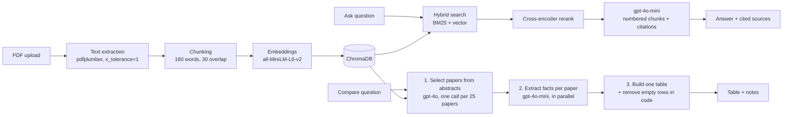

# Study Assistant AI

**An AI study assistant for research papers.** Upload research papers, ask questions with cited sources, and compare dozens of papers in a single table. Built as an end-to-end GenAI project: retrieval-augmented generation, a map-reduce comparison pipeline with its own benchmark, and a QLoRA fine-tuning experiment on a 6 GB laptop GPU in which a local 3B model hallucinates less than gpt-4o-mini.

**Stack:** Python, FastAPI, React (Vite), ChromaDB, sentence-transformers, BM25 + cross-encoder reranking, OpenAI API (gpt-4o-mini / gpt-4o), Unsloth + QLoRA (Llama-3.2-3B).

---

## What it does

| Feature | How it works |
|---|---|
| **Ask** | Hybrid search (BM25 + vector) → cross-encoder rerank → answer from the top chunks. The model reports which chunks it used, so the **Sources** list shows only the papers actually cited. |
| **Refusal** | If the papers don't contain the answer, it says *"I couldn't find this in the provided documents"* and returns **no sources**, instead of guessing. |
| **Compare** | Ask one question across 2–50 papers and get a markdown table, one row per relevant paper, plus notes explaining which papers were left out and why. |
| **Clear failures** | If an OpenAI call fails (no credits, rate limit), the user sees a plain message. Partial or silently incomplete tables are never shown. |
| **Safe uploads** | Only real PDFs (checked by file signature) up to 25 MB are accepted; file names are sanitized and PDFs without extractable text are rejected. CORS is limited to the app's own frontend. |
| **Bookshelf interface** | Papers sit on a 3D bookshelf grouped by topic. Hover pulls a book out, clicking picks it for comparison, and after every answer the papers it came from light up on the shelf. Built with CSS 3D transforms only, and it respects reduced-motion settings. |
| **Rate limits** | Per-IP limits (Ask 10/min, Compare 3/min, uploads 10/hour) plus global daily caps, so a public demo can't run up the OpenAI bill. |
| **Cost control** | Every LLM response is cached on disk, prompts are ordered for OpenAI prompt caching, and each comparison logs its estimated cost. |

---

## Architecture



### Why the comparison pipeline looks like this

The comparison feature went through several designs. Each change was driven by a failure seen on a 45-paper corpus:

1. **One big prompt:** sending all papers at once hit **261k tokens** (limit 128k) and crashed.
2. **Map-reduce over retrieved chunks:** no more crashes, but relevance was judged from a few similar-looking chunks per paper. For *"how do these papers reduce the complexity of self-attention?"* the table had **23 rows, roughly 12 of them wrong** (ALBERT, LoRA, Switch Transformer…).
3. **Select from abstracts, then extract:** relevance is decided once, from every paper's title and abstract, in a single call that sees all candidates side by side. Facts are then extracted only for selected papers, and complexity expressions like `O(n log n)` are checked against the source text before they are allowed into the table.
4. **Primary-only tables:** papers where the topic is only one component ("partial") were the main source of wrong rows. They are now listed below the table with a one-line reason instead of inside it.

### A data bug hiding behind the prompt problems

After a long round of prompt tuning, a simple database report (`src/db_tools.py`) showed that papers had far fewer chunks than their page counts suggested. The cause was in text extraction, not in the prompts: with default settings, pdfplumber glued words together on many arXiv PDFs (`AsTransferLearningfromlarge-scale...`). That had three effects:

- **Keyword search (BM25) was nearly blind,** because words like *distillation* only existed inside long glued strings.
- **Chunks were far larger than intended.** A "500-word" chunk held about 1,600 real words, and the embedding model only reads the first 256 tokens, so most of each chunk was invisible to vector search.
- Facts deep inside a paper, like numbers in tables, were often unreachable.

**Fix:** extract with `x_tolerance=1` (DistilBERT went from 827 to 2,820 words), and use 180-word chunks so every chunk fits the embedding model's 256-token limit. The 40-paper index grew from about 1,000 to **3,944 chunks**. Chinchilla's "1.4T training tokens", which the comparison benchmark had failed on every run before the fix, now passes.

---

## Evaluation

### Ask mode (`src/evaluation.py`)

35 questions over the 40-paper corpus, scored in code (no LLM judge): the expected paper must appear in the cited sources, and the answer must contain the key fact (e.g. *175* for GPT-3's parameter count, *28.4* for the Transformer's WMT14 EN-DE BLEU). Five questions have no answer in the papers and must be refused.

| Metric | Result |
|---|---|
| Correct source cited | **30 / 30** |
| Key fact in the answer | **30 / 30** |
| Wrongly refused | 0 / 30 |
| Correctly refused (unanswerable) | **5 / 5** |
| Hallucinated on unanswerable | 0 / 5 |
| Median latency | 2.4 s |
| Cost per run | about $0.01 |

*These are direct factual questions, and most of them name the paper. A perfect score here means the basics work, not that the system is perfect. Harder questions (not naming the paper, facts buried in tables, questions spanning several papers) are next on the roadmap.*

### Comparison benchmark (`src/compare_eval.py`)

Five fixed questions over the 40-paper corpus, each with expected papers and number checks (e.g. Chinchilla's row must say 70B and 1.4T, and must not contain Gopher's 280B). One question is a **trap** with no correct answer (image segmentation in an NLP corpus).

| Metric | Before text-extraction fix | After |
|---|---|---|
| Paper selection precision | 0.96 | **1.00** |
| Paper selection recall | 0.92 | 0.92 |
| Number checks | 4 / 6 | 4 / 6 (Chinchilla now passes) |
| Empty "Not stated" rows | 0 | 0 |
| Trap question (should return "not found") | passed | passed |
| Time for 5 questions | ~47 s | ~35 s |
| Cost per run | | about $0.15 |

*gpt-4o selects the papers and gpt-4o-mini extracts facts. LLM outputs vary between runs, so treat these as indicative. The remaining misses are GPT-3 sometimes not being selected for the model-size question, and Mixtral's row reporting only its 13B active parameters.*

### Fine-tuning experiment (`finetune/`)

**Question:** can a small local model answer from retrieved context, cite the chunk it used, and refuse when the answer isn't there?

**Setup:** Llama-3.2-3B-Instruct (4-bit) with QLoRA (rank 16) via Unsloth, trained on an **RTX 3060 Laptop GPU (6 GB)**, peak VRAM 4.5 GB.

| | v1 | v2 |
|---|---|---|
| Training data | 1,041 examples, one context chunk each; text had glued words; ~32% cut off by the 2,048-token limit | 2,097 examples built like the real app: 5 numbered chunks from our own retrieval (vector search + reranker), with distractors; ~7% dropped as too long |
| Unanswerable examples | question and context from the same chunk | a real question about paper X, with context only from *other* papers |
| Target format | plain answer | answer + `USED_CHUNKS: n` (the citation format the app parses) |
| Training | 2 epochs, 41 min | 1 epoch, 72 min |

**Benchmark v2:** 150 questions (100 answerable, 50 unanswerable) from 5 papers that were never used in training. The same prompt goes to every model, gpt-4o-mini judges correctness, and citations are checked in code against the chunk that holds the answer.

| Metric | Base 3B | Fine-tuned v1 | **Fine-tuned v2** | gpt-4o-mini |
|---|---|---|---|---|
| Correct | 43% | 61% | 56% | 62% |
| Partially correct | 48% | 34% | 33% | 28% |
| Incorrect | 8% | 4% | 4% | 2% |
| Wrongly refused | 1% | 1% | 7% | 8% |
| Correctly refused | 66% | 66% | **92%** | 74% |
| **Hallucinated** | 34% | 34% | **8%** | 26% |
| **Citation accuracy** | 45% | 1% | **85%** | 81% |
| Median latency | 2.4 s | 2.7 s | 2.7 s | API |

**Takeaways**

- **v2 hallucinates on 8% of unanswerable questions, against 26% for gpt-4o-mini and 34% for the base model,** and it cites the right chunk more often than gpt-4o-mini (85% vs 81%), while running locally for free.
- It is about 6 points behind gpt-4o-mini on fully correct answers and refuses slightly more often when the answer *is* there (7%). The model became more cautious; that is the trade-off.
- **v1 looked good on its own easy test (8% hallucination) but hallucinates 34% of the time once the context contains realistic distractors.** It also never learned the citation format. Evaluating in conditions that match real use changed the conclusion.
- The test set is small (100 + 50 questions), so differences of a few points are within noise. The hallucination and citation gaps are large enough to matter.

The earlier v1-only benchmark (single-chunk contexts) is in `finetune/benchmark_results.json`.

---

## Known limitations

- **Small fine-tuning test set:** differences of a few percentage points may be noise.
- **The fine-tuned model is not served by the app yet.** The app uses the OpenAI API; plugging in the local v2 model is the next step.
- **Numbers that live in tables** can still be missed or attributed to the wrong model when retrieval doesn't surface the right chunk.
- **The trap question doesn't pass every run.** The selector occasionally picks loosely related papers when nothing fits.
- **Borderline papers are not always selected.** GPT-3, whose abstract is mostly about few-shot prompting, is sometimes skipped for questions about model size.
- **Rate limits are in memory:** they reset when the server restarts and are not shared across multiple server instances.

---

## Project structure

```
ai-study-assistant/
├── src/
│   ├── main.py            # FastAPI app: /upload, /ask, /compare, /documents
│   ├── pdf_reader.py      # PDF text extraction
│   ├── chunker.py         # 180-word chunks with 30-word overlap
│   ├── embed_store.py     # embeddings + ChromaDB storage
│   ├── hybrid_search.py   # BM25 + vector search + cross-encoder rerank
│   ├── rag_pipeline.py    # Ask: answer with cited sources
│   ├── db_tools.py        # database report + safe document removal
│   ├── comparison.py      # Compare: select → extract → table, with cache + cost log
│   ├── compare_eval.py    # comparison benchmark
│   ├── evaluation.py      # Ask-mode evaluation
│   ├── make_dataset.py    # fine-tuning dataset v1
│   ├── make_dataset_v2.py # fine-tuning dataset v2 (realistic retrieval contexts)
│   ├── eval_judge.py      # LLM-as-judge for the v1 benchmark
│   └── eval_judge_v2.py   # base vs v1 vs v2 vs gpt-4o-mini benchmark
├── finetune/              # QLoRA training (train.py, train_v2.py) and generation scripts
└── frontend/              # React UI
```

---

## Running it locally

**Requirements:** Python 3.10, Node.js, an OpenAI API key.

1. Create the environment and install dependencies:
   ```bash
   python -m venv venv
   venv\Scripts\activate          # Windows
   pip install -r requirements.txt
   ```
2. Create a `.env` file in the project root:
   ```
   OPENAI_API_KEY=your-key-here
   ```
3. Put PDFs in `data/` and index them (or upload them from the UI later):
   ```bash
   cd src
   python -c "from embed_store import process_all_pdfs; process_all_pdfs()"
   ```
4. Start the backend:
   ```bash
   uvicorn main:app --reload
   ```
5. Start the frontend in a second terminal:
   ```bash
   cd frontend
   npm install
   npm run dev
   ```
6. Open http://localhost:5173

Run the comparison benchmark with `python compare_eval.py` from `src/`. Cached responses make repeat runs free. Set `LLM_CACHE=0` to force fresh calls.

---

## Roadmap

- Serve the fine-tuned v2 model as a free, local option for Ask mode
- Harder Ask-mode benchmark: questions that don't name the paper, table facts, multi-paper questions
- Document filter in Ask mode and a summarization feature
- Public deployment (backend on Hugging Face Spaces, frontend on Vercel)
