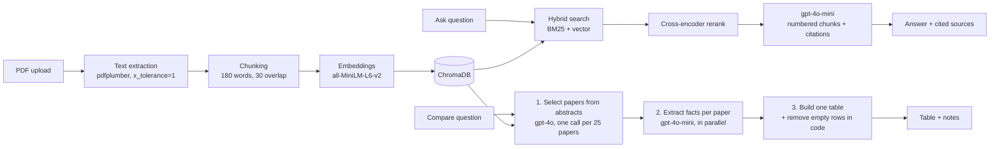

# AI Study Assistant

Upload research papers, ask questions with cited sources, and compare dozens of papers in a single table. Built as an end-to-end GenAI project: retrieval-augmented generation, a map-reduce comparison pipeline with its own benchmark, and a QLoRA fine-tuning experiment on a 6 GB laptop GPU.

**Stack:** Python, FastAPI, React (Vite), ChromaDB, sentence-transformers, BM25 + cross-encoder reranking, OpenAI API (gpt-4o-mini / gpt-4o), Unsloth + QLoRA (Llama-3.2-3B).

---

## What it does

| Feature | How it works |
|---|---|
| **Ask** | Hybrid search (BM25 + vector) → cross-encoder rerank → answer from the top chunks. The model reports which chunks it used, so the **Sources** list shows only the papers actually cited. |
| **Refusal** | If the papers don't contain the answer, it says *"I couldn't find this in the provided documents"* and returns **no sources**, instead of guessing. |
| **Compare** | Ask one question across 2–50 papers and get a markdown table, one row per relevant paper, plus notes explaining which papers were left out and why. |
| **Clear failures** | If an OpenAI call fails (no credits, rate limit), the user sees a plain message. Partial or silently incomplete tables are never shown. |
| **Safe uploads** | Only real PDFs (checked by file signature) up to 25 MB are accepted; file names are sanitized and PDFs without extractable text are rejected. CORS is limited to the app's own frontend. |
| **Cost control** | Every LLM response is cached on disk, prompts are ordered for OpenAI prompt caching, and each comparison logs its estimated cost. |

---

## Architecture



### Why the comparison pipeline looks like this

The comparison feature went through several designs. Each change was driven by a failure seen on a 45-paper corpus:

1. **One big prompt:** sending all papers at once hit **261k tokens** (limit 128k) and crashed.
2. **Map-reduce over retrieved chunks:** no more crashes, but relevance was judged from a few similar-looking chunks per paper. For *"how do these papers reduce the complexity of self-attention?"* the table had **23 rows, roughly 12 of them wrong** (ALBERT, LoRA, Switch Transformer…).
3. **Select from abstracts, then extract:** relevance is decided once, from every paper's title and abstract, in a single call that sees all candidates side by side. Facts are then extracted only for selected papers, and complexity expressions like `O(n log n)` are checked against the source text before they are allowed into the table.
4. **Primary-only tables:** papers where the topic is only one component ("partial") were the main source of wrong rows. They are now listed below the table with a one-line reason instead of inside it.

### A data bug hiding behind the prompt problems

After a long round of prompt tuning, a simple database report (`src/db_tools.py`) showed that papers had far fewer chunks than their page counts suggested. The cause was in text extraction, not in the prompts: with default settings, pdfplumber glued words together on many arXiv PDFs (`AsTransferLearningfromlarge-scale...`). That had three effects:

- **Keyword search (BM25) was nearly blind,** because words like *distillation* only existed inside long glued strings.
- **Chunks were far larger than intended.** A "500-word" chunk held about 1,600 real words, and the embedding model only reads the first 256 tokens, so most of each chunk was invisible to vector search.
- Facts deep inside a paper, like numbers in tables, were often unreachable.

**Fix:** extract with `x_tolerance=1` (DistilBERT went from 827 to 2,820 words), and use 180-word chunks so every chunk fits the embedding model's 256-token limit. The 40-paper index grew from about 1,000 to **3,944 chunks**. The evaluation numbers below were measured *before* this fix and will be re-run.

---

## Evaluation

### Comparison benchmark (`src/compare_eval.py`)

Five fixed questions over a 45-document corpus (measured before the text-extraction fix above), each with expected papers and number checks (e.g. Chinchilla's row must say 70B and 1.4T, and must not contain Gopher's 280B). One question is a **trap** with no correct answer (image segmentation in an NLP corpus).

| Metric | Result |
|---|---|
| Paper selection precision | **0.96** |
| Paper selection recall | **0.92** |
| Number checks | 4 / 6 |
| Empty "Not stated" rows | 0 |
| Trap question (should return "not found") | passed |
| Time for 5 questions | ~47 s |

*Single run with gpt-4o selection and gpt-4o-mini extraction. LLM outputs vary between runs, so treat these as indicative, not exact.*

### Fine-tuning experiment (`finetune/`)

**Question:** can a small local model learn to answer from context and refuse when the answer isn't there?

- **Model:** Llama-3.2-3B-Instruct (4-bit) with QLoRA (rank 16), trained with Unsloth on an **RTX 3060 Laptop GPU (6 GB)**
- **Data:** 1,041 question–context–answer examples generated from arXiv papers, including unanswerable questions. Split by paper (936 train / 105 validation) so the same paper never appears in both.
- **Training:** 2 epochs, LR 1e-4, ~41 minutes, peak VRAM **4.5 GB**, final train loss 0.30, validation loss 0.19
- **Judging:** gpt-4o-mini as an LLM judge on a held-out test set

| Metric | Base model | Fine-tuned | Change |
|---|---|---|---|
| Correct answers | 64% | **71%** | +7 pts |
| Partially correct | 22% | 18% | −4 pts |
| Incorrect | 10% | 8% | −2 pts |
| Wrongly refused (answer was in context) | 4% | 3% | −1 pt |
| Correctly refused (answer not in context) | 86% | **92%** | +6 pts |
| Hallucinated (answered when it should refuse) | 14% | **8%** | −6 pts |

**Takeaway:** the fine-tuned 3B model answers more questions correctly and hallucinates less often on unanswerable questions, without becoming more refusal-happy.

---

## Known limitations

- **Small fine-tuning test set:** differences of a few percentage points may be noise.
- **Truncation during training:** examples longer than 2,048 tokens were cut, which dropped about 32% of the training examples. A v2 with shorter chunks and a longer sequence length is planned.
- **The fine-tuned model is an experiment.** The app currently uses the OpenAI API for answers.
- **Numbers that live in tables** (e.g. Chinchilla's 1.4T training tokens) are sometimes missed or attributed to the wrong model, because retrieval doesn't always surface the right chunk.
- **The trap question doesn't pass every run.** The selector occasionally picks loosely related papers when nothing fits.
- **No rate limiting yet:** a public deployment needs per-user limits so nobody can run up the OpenAI bill.
- **Fine-tuning data was generated before the text-extraction fix,** so some training contexts contain glued words. v2 will regenerate the data.

---

## Project structure

```
ai-study-assistant/
├── src/
│   ├── main.py            # FastAPI app: /upload, /ask, /compare, /documents
│   ├── pdf_reader.py      # PDF text extraction
│   ├── chunker.py         # 180-word chunks with 30-word overlap
│   ├── embed_store.py     # embeddings + ChromaDB storage
│   ├── hybrid_search.py   # BM25 + vector search + cross-encoder rerank
│   ├── rag_pipeline.py    # Ask: answer with cited sources
│   ├── db_tools.py        # database report + safe document removal
│   ├── comparison.py      # Compare: select → extract → table, with cache + cost log
│   ├── compare_eval.py    # comparison benchmark
│   ├── evaluation.py      # Ask-mode evaluation
│   ├── make_dataset.py    # fine-tuning dataset generation
│   └── eval_judge.py      # LLM-as-judge for the fine-tuning benchmark
├── finetune/              # QLoRA training + generation scripts
└── frontend/              # React UI
```

---

## Running it locally

**Requirements:** Python 3.10, Node.js, an OpenAI API key.

1. Create the environment and install dependencies:
   ```bash
   python -m venv venv
   venv\Scripts\activate          # Windows
   pip install -r requirements.txt
   ```
2. Create a `.env` file in the project root:
   ```
   OPENAI_API_KEY=your-key-here
   ```
3. Put PDFs in `data/` and index them (or upload them from the UI later):
   ```bash
   cd src
   python -c "from embed_store import process_all_pdfs; process_all_pdfs()"
   ```
4. Start the backend:
   ```bash
   uvicorn main:app --reload
   ```
5. Start the frontend in a second terminal:
   ```bash
   cd frontend
   npm install
   npm run dev
   ```
6. Open http://localhost:5173

Run the comparison benchmark with `python compare_eval.py` from `src/`. Cached responses make repeat runs free. Set `LLM_CACHE=0` to force fresh calls.

---

## Roadmap

- Fine-tuning v2: shorter chunks, ~2,500–3,000 examples, longer sequence length; compare base vs v1 vs v2
- Re-run the comparison benchmark after the text-extraction fix
- Ask-mode benchmark on the 40-paper corpus (accuracy, hallucination rate, latency, cost)
- Document filter in Ask mode and a summarization feature
- Rate limiting and deployment
